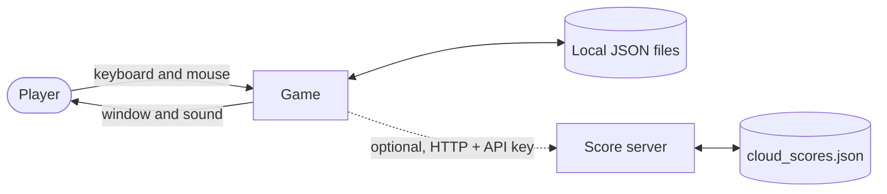
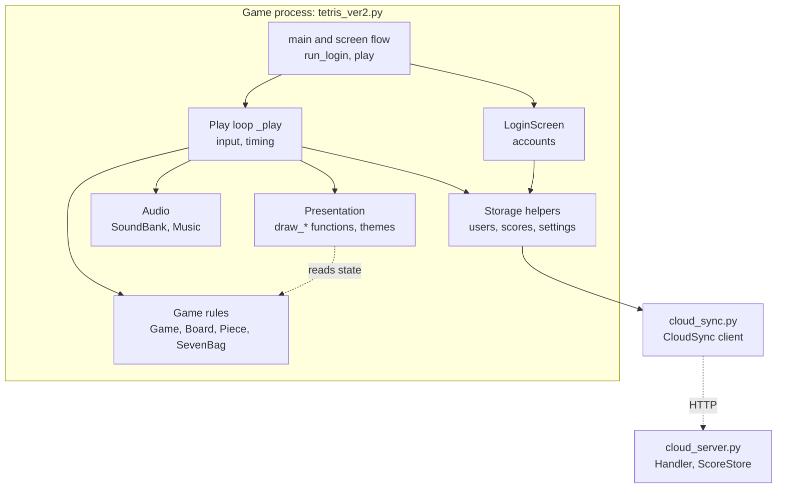
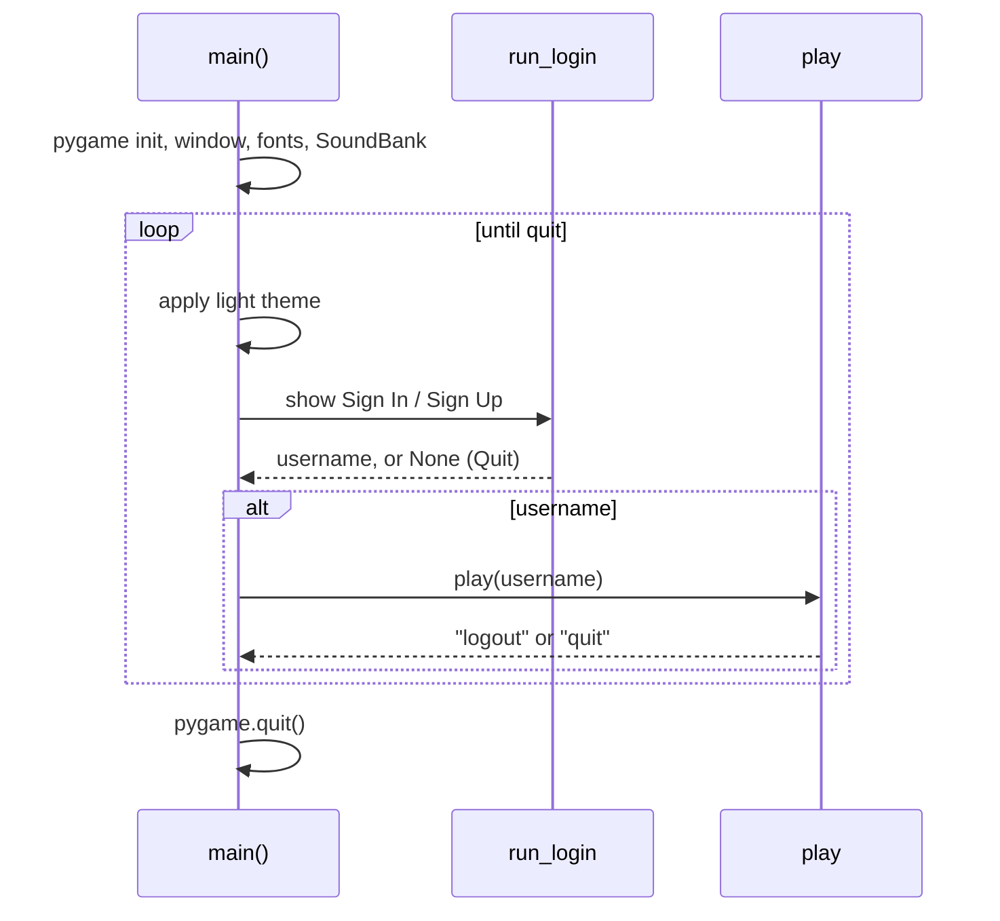
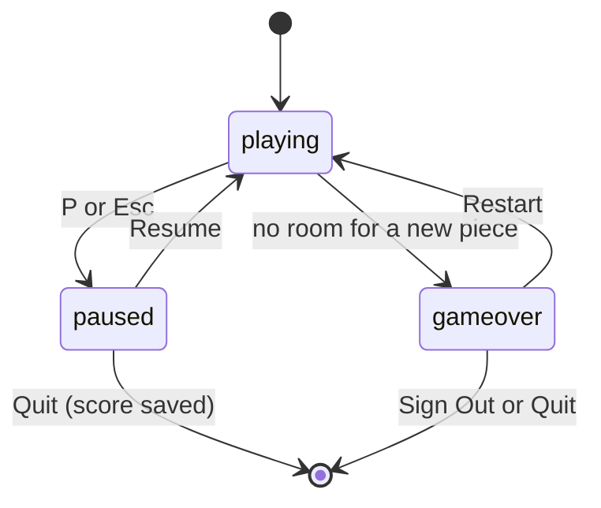
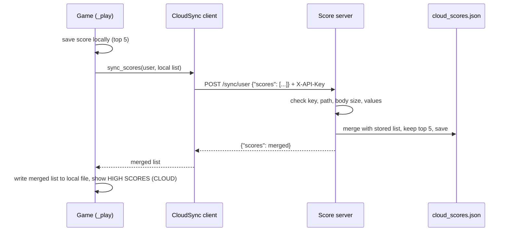

# Tetris 2.0: Architecture

This document describes the big picture: what the system is made of, how the parts talk to each other, what happens at run time, where data lives, and how it is deployed. For the inside of each part (classes, algorithms, data formats), see `SOFTWARE_DESIGN.md`.

---

## 1. System Context

Tetris 2.0 is a desktop game. It runs on one player's computer and, only if the player turns it on, talks to a small score server.



| Actor or system | Role |
|---|---|
| **Player** | Plays, signs in and out, optionally runs the score server |
| **Game** | The desktop program (`tetris_ver2.py`) |
| **Local files** | Accounts, scores, and settings next to the game |
| **Score server** | Optional self-hosted API (`cloud_server.py`) that merges and stores high scores |

There are no accounts on the internet, no third-party services, and no data sent anywhere unless the player sets `TETRIS_CLOUD_URL`.

---

## 2. Architectural Style

- **Single-process desktop application** with a classic **game loop** (read input, update, draw, repeat at 60 frames per second).
- **Layered inside the process:** rules at the center, with presentation, storage, and network layers around them.
- **Client and server** only for the optional score sync. The server is a separate small program.
- **Offline first:** every outside dependency (audio, files, network) has a safe fallback, so the game always starts and always plays.

---

## 3. Components



| Component | Responsibility | Depends on |
|---|---|---|
| **Screen flow** (`main`, `run_login`, `play`) | Decides which screen is active: sign in, then play, then back or quit | Login, Loop |
| **LoginScreen** | Sign In and Sign Up logic, validation, password check | Storage |
| **Play loop** (`_play`) | Turns events into game actions, advances time, drains sound events, drives music and drawing, saves and syncs at the right moments | Rules, Draw, Audio, Storage |
| **Game rules** | All gameplay: movement, rotation, locking, scoring, T-spins, combos, bombs, levels, pause, game over | Nothing outside itself (pure logic) |
| **Presentation** | Paints the board, pieces, ghost, HUD, panels, effects, menus, login pages; applies themes | pygame, reads Game state |
| **Audio** | Builds sounds and music in code and plays them; silent if no device | pygame mixer |
| **Storage helpers** | Load and save accounts, scores, and settings as validated JSON | File system |
| **CloudSync client** | Sends local scores to the server and returns the merged list | Network (standard library) |
| **Score server** | Authenticates requests, validates input, merges and stores scores | File system, network |

**Key dependency rule:** the rules component does not import drawing, audio, files, or network. Everything else depends on it, never the other way around.

---

## 4. Layers

| Layer | Contains | May use |
|---|---|---|
| **Presentation and input** | Draw functions, login layout, button hit testing, the play loop's event handling | Domain, Services |
| **Application flow** | `main`, `run_login`, `play`, save and sync decisions | Presentation, Domain, Services |
| **Domain (rules)** | `Piece`, `Board`, `SevenBag`, `Game`, scoring and kick tables | Only itself |
| **Services** | `SoundBank`, `Music`, storage helpers, `CloudSync` | Libraries, files, network |

Rules never reach up. The only link from rules to the outside is the `game.events` list, which the loop reads each frame and passes to the audio service.

---

## 5. Runtime View

### 5.1 Start-up and screen flow



### 5.2 One frame of play

```mermaid
sequenceDiagram
    participant Loop as _play
    participant Game
    participant Audio as SoundBank / Music
    participant Draw as draw_* functions
    Loop->>Loop: dt = clock.tick(60) / 1000
    Loop->>Game: events become actions (move, rotate, hold, bomb, pause)
    Loop->>Game: update(dt)
    Game-->>Loop: events list (lock, clear, tspin, bomb, ...)
    Loop->>Audio: play each event name, then clear the list
    Loop->>Audio: Music.update(level, state, muted)
    Loop->>Draw: draw board, piece, ghost, HUD, panels, effects
    Loop->>Loop: flip display
```

### 5.3 Game states



While `paused`, `update()` does nothing, so time, gravity, and the lock timer stop. Actions (move, rotate, bomb, hold) are ignored in any state except `playing`.

### 5.4 Piece life cycle

```
spawn → fall (gravity) / move / rotate (SRS kicks) → grounded
      → lock delay (0.5 s, up to 15 resets)  ──┐
      → hard drop (instant)  ──────────────────┤
                                               ▼
        lock → clear rows → score, combo, back-to-back, bomb earned → next piece
```

---

## 6. Data Architecture

| Data | Location | Format | Owner |
|---|---|---|---|
| Accounts | `users.json` | JSON object keyed by lowercase username: name, salt, hash, iterations | Accounts code |
| Player scores | `scores/<user>.json` | JSON list of up to 5 integers | Scores code |
| Player settings | `settings/<user>.json` | JSON object: `theme`, `muted` | Settings code |
| Server scores | `cloud_scores.json` | JSON object keyed by lowercase username: list of integers | `ScoreStore` |
| Game session | Memory only | `Game` object | Play loop |

**Principles**

- **Per player files** keep one player's data apart from another's.
- **Validate on load:** wrong shape, bad JSON, or missing files give safe defaults instead of errors.
- **Atomic server writes:** write to a temporary file, then rename.
- **No secrets in clear text:** only salted PBKDF2 hashes are stored; the API key lives in an environment variable.
- **Not tracked by git:** `users.json`, `scores/`, `settings/`, and `cloud_scores.json`.

---

## 7. Cloud Sync Architecture

### 7.1 Overview



When does it run: at game over, on Sign Out, and on Quit from the pause menu or after game over (not on Restart).

### 7.2 API

| Request | Auth | Purpose |
|---|---|---|
| `GET /health` | none | Server is up |
| `GET /scores/<user>` | key | Read a player's top scores |
| `POST /scores/<user>` `{"score": n}` | key | Add one score |
| `POST /sync/<user>` `{"scores": [...]}` | key | Merge a list, return the top 5 |

Replies are JSON. Status codes: 200 success, 400 bad input, 401 wrong or missing key, 404 unknown path or invalid username.

### 7.3 Merge rule

For each score value, keep the larger of its count in the two lists, sort high to low, keep 5. This makes a sync repeatable (no double counting) and order independent.

### 7.4 Failure behavior

If sync is off, the server is down, the key is wrong, or the reply is bad, `CloudSync` returns `None` and the game keeps the local scores with no error shown. The client waits at most 1.5 seconds per request.

### 7.5 Server internals

`ThreadingHTTPServer` handles requests on separate threads. `ScoreStore` uses a lock around every read-modify-write so two players syncing at once cannot overwrite each other.

---

## 8. Concurrency Model

| Part | Model |
|---|---|
| **Game** | Single thread. One loop does input, rules, audio calls, and drawing |
| **Audio** | pygame's mixer plays sounds in its own audio thread; the game only starts, pauses, and stops channels |
| **Cloud sync** | Blocking call on the game thread, up to 1.5 seconds, and only at save points |
| **Server** | One thread per request, with a lock on the data file |

---

## 9. Deployment View

```mermaid
flowchart LR
    subgraph Player's computer
        A[tetris_ver2.py<br/>cloud_sync.py] --> B[(users.json<br/>scores/<br/>settings/)]
    end
    subgraph Any reachable computer, optional
        C[cloud_server.py] --> D[(cloud_scores.json)]
    end
    A -. TETRIS_CLOUD_URL + KEY .-> C
```

| Item | Details |
|---|---|
| **Runtime** | Python 3 and pygame on the player's computer |
| **Game files** | `tetris_ver2.py` and `cloud_sync.py` in the same folder |
| **Server files** | `cloud_server.py` and `cloud_sync.py` in the same folder |
| **Server dependencies** | Python standard library only |
| **Configuration** | Environment variables `TETRIS_CLOUD_URL`, `TETRIS_CLOUD_KEY`; server flags `--host`, `--port`, `--key` |
| **Default exposure** | Server listens on `127.0.0.1` only |
| **Same machine or different** | Works with the server on the same computer or on another one on the network |

---

## 10. Technology Choices

| Choice | Reason |
|---|---|
| **Python 3** | Readable, fast to build and test, runs everywhere |
| **pygame** | Simple window, input, drawing, and sound for a 2D game |
| **JSON files** | Human readable, no database to install |
| **Standard library HTTP server and client** | No extra packages for the optional sync |
| **PBKDF2-HMAC-SHA256** | Standard password hashing available in Python without extra packages |
| **Generated audio** | No audio files to package; works the same everywhere |
| **`unittest`** | Included with Python |

---

## 11. Quality Attributes

| Attribute | How the architecture supports it |
|---|---|
| **Testability** | Rules are pure logic; the server runs on a free port in tests; dummy video and audio drivers allow headless runs |
| **Reliability** | Validated loads, atomic server saves, and fail-soft audio and network |
| **Security** | Hashed passwords, validated names and inputs, constant-time key check, size limits, local-only server by default, network off by default |
| **Performance** | Light per-frame work; music loops are built once per tempo and cached; clamped gravity |
| **Portability** | Pure Python plus pygame; no platform-specific code |
| **Modifiability** | Rule numbers are constants; new sounds, themes, or kick tables are data entries; the server and client are separate files |
| **Usability** | Mouse-driven menus, on-screen hints, and a clear game over summary |

---

## 12. Extension Points

| To add... | Change |
|---|---|
| **A new theme** | Add an entry to `THEMES` and `THEME_ORDER` (each theme must color all 7 pieces; a test checks it) |
| **A new sound** | Add a name to `SOUND_NOTES`, then append that name to `game.events` where it happens |
| **A new scoring rule** | Add a constant near the scoring tables and use it in `_lock_active_piece` |
| **A new power-up** | Add state to `Game`, an action method like `use_bomb`, a key in `_play`, a HUD line in `draw_hud` |
| **A new API route** | Add a branch in `Handler` and a method in `ScoreStore` and `CloudSync` |
| **A different storage backend** | Replace the load and save helpers; the rest of the game only sees lists and dicts |
| **Rebindable keys** | Replace the key checks in `_play` with a lookup table loaded from the settings file |

---

## 13. Risks and Constraints

| Risk or constraint | Mitigation or note |
|---|---|
| Large single game file | Sections are clearly labeled; splitting into modules is the next refactor |
| Global theme variables | Tests reset the theme after use; a Theme object would be cleaner |
| Blocking sync | Short timeout; background thread is a possible improvement |
| JSON files and many users | Fine for a few local players; a database would be needed for more |
| Shared API key | Use `https` outside a trusted network |
| Unfinished run lost when the window is closed with X | Use Pause > Quit or Sign Out; saving on the quit event is a possible change |
| Real pygame needed for pixel tests | Run the full suite on a machine with pygame installed |
